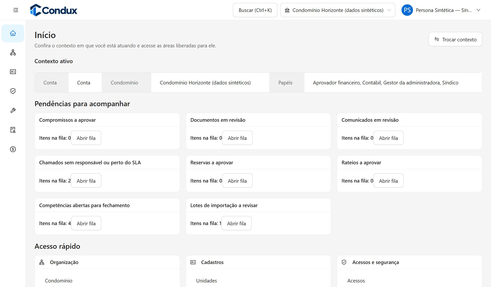
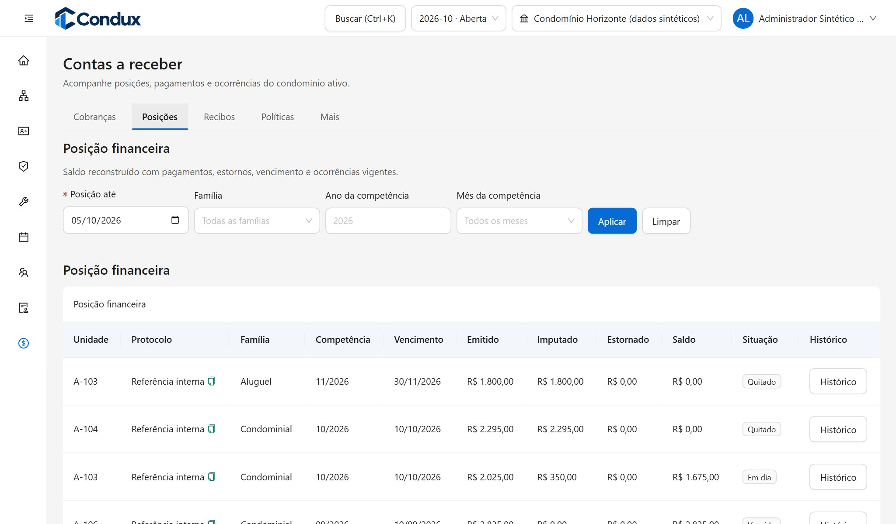
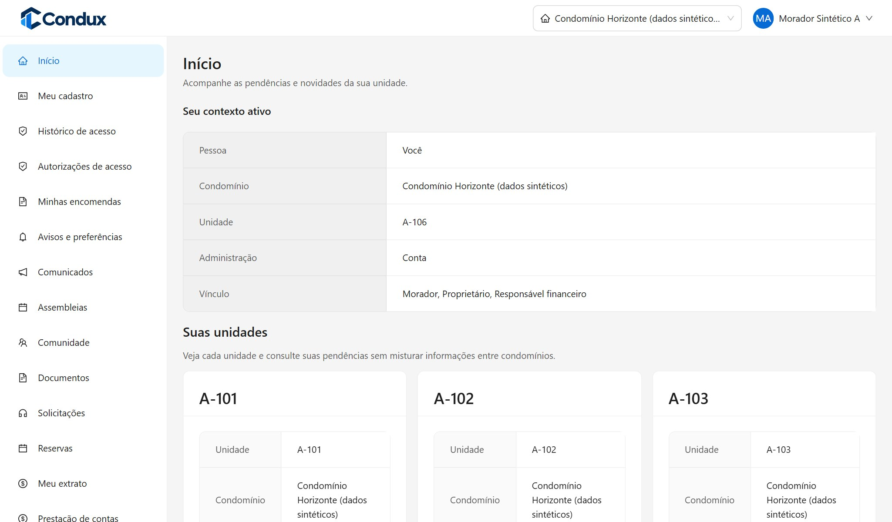
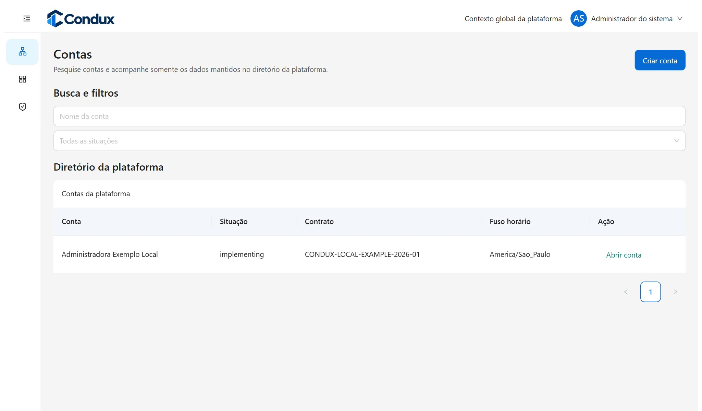

# Condux

**Plataforma de administração condominial para administradoras, síndicos, equipes e moradores.**

> **Código-fonte à venda.** A oportunidade contempla o sistema Condux como um todo: backend e API, worker, banco e módulos de negócio, três aplicações web e o aplicativo móvel multiplataforma para **iOS e Android**. O aplicativo móvel está em desenvolvimento. A negociação define os termos de transferência ou licenciamento, entregáveis e continuidade do desenvolvimento.

[Tenho interesse no Condux](mailto:andrebc@gmail.com?subject=Condux%20-%20c%C3%B3digo-fonte%20%C3%A0%20venda)

Este repositório é apenas de apresentação: contém documentação e imagens demonstrativas, **sem o código-fonte do produto**.

## Visão do produto

O Condux reúne em uma plataforma a operação de administradoras que gerenciam vários condomínios. O produto foi concebido para centralizar rotinas administrativas, financeiras e operacionais, respeitando o contexto, as permissões e os dados de cada condomínio.

O escopo funcional contempla, entre outras áreas:

- cadastro de administradoras, condomínios, pessoas, unidades, vínculos e acessos;
- contas a receber e a pagar, tesouraria, orçamento, rateios, contabilidade e prestação de contas;
- comunicados, documentos, solicitações, reservas e serviços do portal do morador;
- portaria, visitantes, autorizações de acesso, encomendas, ocorrências e rotinas de funcionários;
- suprimentos, fornecedores, patrimônio, manutenção, seguros e garantias condominiais e locatícias.

## Aplicações incluídas no escopo

| Aplicação | Público e finalidade |
| --- | --- |
| **Back-office** | Administração da carteira, cadastros, operação, financeiro e gestão dos condomínios. |
| **Portal do morador** | Acesso de moradores e locadores a serviços, informações, documentos e solicitações autorizados. |
| **Console da plataforma** | Operação da plataforma e gestão das contas, separado dos dados de cada condomínio. |
| **Aplicativo móvel iOS e Android** | Um aplicativo multiplataforma para moradores, responsáveis financeiros, portaria, funcionários e síndicos, com experiência conforme o contexto ativo. A implementação está em andamento. |

## Imagens do sistema web

As telas abaixo vêm do ambiente demonstrativo do Condux. Os dados exibidos são sintéticos.

### Back-office — visão geral

### Financeiro — posição de contas a receber

### Portal do morador

### Console da plataforma

## Aplicativo móvel para iOS e Android

O produto prevê **um único aplicativo Expo/React Native para iOS e Android**. A implementação está em andamento. As imagens a seguir são conceitos visuais de jornadas por perfil — não são capturas do aplicativo pronto nem comprovam que as telas estejam concluídas.

| Morador | Portaria | Síndico |
| --- | --- | --- |
|  |  |  |

## Arquitetura em resumo

- **Backend:** C# e .NET, organizado como monólito modular; API e worker podem ser implantados separadamente.
- **Aplicações web:** React, TypeScript e Ant Design, com back-office, portal do morador e console da plataforma.
- **Aplicativo móvel:** React Native e Expo, em desenvolvimento para iOS e Android.
- **Dados:** PostgreSQL, com isolamento por tenant e políticas de segurança no banco.
- **Integração e identidade:** RabbitMQ, OpenAPI e Keycloak.
- **Infraestrutura:** ambiente local em k3d/Kubernetes, com configuração e documentação operacional no projeto-fonte.

## Situação e transparência

- O projeto-fonte documenta as aplicações web e o backend em execução local com dados sintéticos.
- Ambientes de produção e homologação ainda não foram provisionados.
- O aplicativo móvel iOS/Android está em desenvolvimento; os conceitos visuais desta página servem como referência de experiência.
- O repositório `condux_project` é destinado à apresentação comercial e documental. O código do produto faz parte da negociação e não está publicado aqui.

## Negociação

O código-fonte está à venda. O escopo pretendido inclui a plataforma completa e o aplicativo móvel para iOS e Android, considerando o estado atual de desenvolvimento. Valores, modalidade de transferência/licenciamento e plano de continuidade são definidos diretamente.

**Contato:** [andrebc@gmail.com](mailto:andrebc@gmail.com?subject=Condux%20-%20c%C3%B3digo-fonte%20%C3%A0%20venda)
